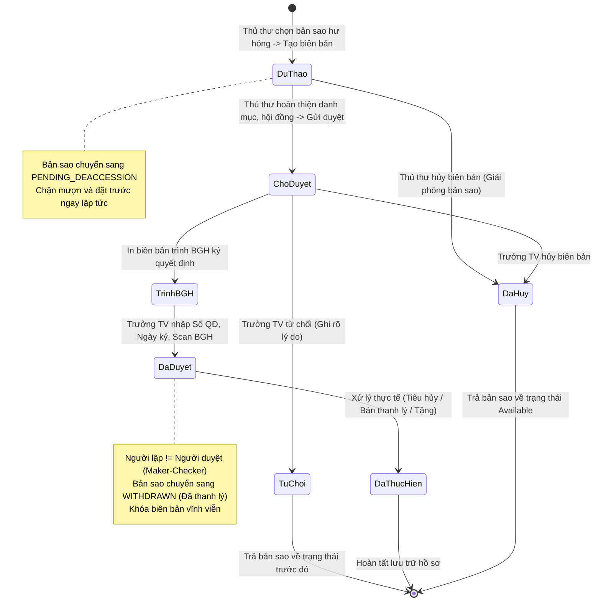
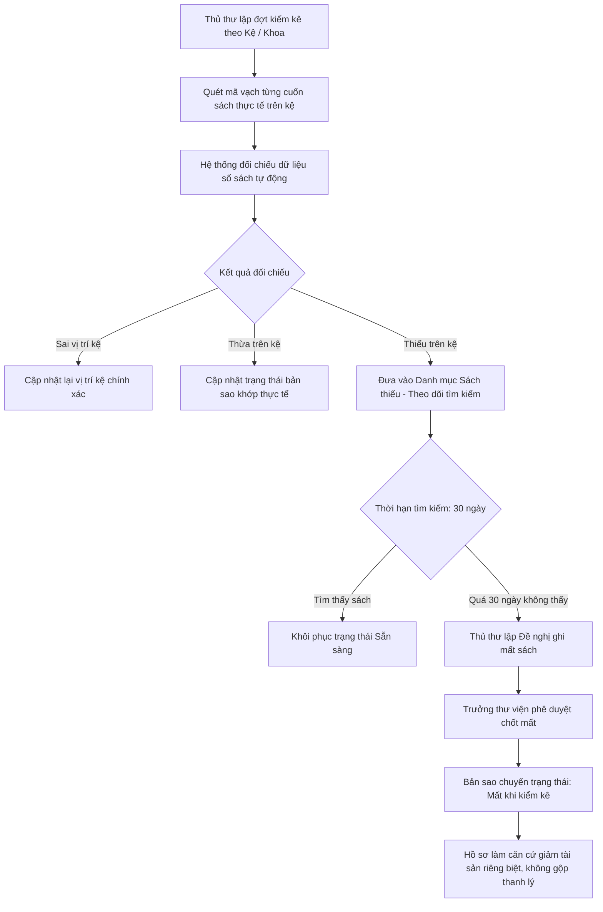

# TÀI LIỆU MÔ TẢ NGHIỆP VỤ, CHỨC NĂNG VÀ PHÂN QUYỀN HỆ THỐNG
# HỆ THỐNG QUẢN LÝ THƯ VIỆN UTH (DIGITAL LIBRARY PORTAL) — v2.1

> **Cơ quan chủ quản:** Trường Đại học Giao thông Vận tải TP.HCM (UTH)  
> **Căn cứ pháp lý:** Thông tư 02/2020/TT-BVHTTDL ngày 25/05/2020 quy định về bảo quản, thanh lọc tài liệu trong thư viện  
> **Phiên bản tài liệu:** 2.1 — Chuẩn hóa nghiệp vụ Thư viện Đại học thực tế  
> **Cập nhật:** 20/11/2026  
> **Phương pháp tiếp cận:** 100% dựa trên hiện trạng Source Code Backend, Frontend & Cơ sở Dữ liệu

---

## 1. TỔNG QUAN HỆ THỐNG

### 1.1. Kiến trúc Kỹ thuật
- **Backend:** Django 5.x + Django REST Framework (DRF) + PostgreSQL 16 (Port 5433).
- **Frontend:** React 18 (`18.3.1`) + TypeScript (`5.6.3`) + Vite (`5.4.8`) + Tailwind CSS (`3.4.13`).
- **Xác thực:** JSON Web Token (JWT) với silent refresh rotation tự động qua `/api/v1/auth/refresh`.
- **Bảo mật & Tích hợp:** Mã vạch chuẩn Code128, Dynamic DRM Watermark (chống chụp lén/phát tán PDF), Cổng thanh toán VietQR / SePay Webhook tự động đối soát giao dịch thu phí làm thẻ và thu phạt.

### 1.2. Nguyên tắc Quản lý Vai trò (Role Management)
- Trường `role` lưu trực tiếp trên bảng `users` (`apps/accounts/models.py`), mã hóa trong JWT token.
- Phân tầng quyền hạn ở Backend sử dụng các Custom Permissions tại [backend/apps/accounts/permissions.py](file:///d:/UTH-Library/backend/apps/accounts/permissions.py):
  - `IsAdminUserRole`: Cho phép Cán bộ thư viện (`admin` và `librarian`).
  - `IsAdminOnlyRole`: Giới hạn độc quyền cho Trưởng thư viện / Quản trị viên (`admin`).
  - `IsStudentOrLecturer`: Dành riêng cho Bạn đọc (`student` và `lecturer`).
  - `IsOwnerOrAdmin`: Cho phép chủ sở hữu bản ghi hoặc Cán bộ thư viện.
- Ở Frontend, `AuthContext.tsx` và `ProtectedRoute` (`Router.tsx`) quản lý ẩn/hiện giao diện tương ứng.

---

## 2. DANH SÁCH VAI TRÒ (ROLES)

Định nghĩa tại: [backend/apps/core/enums.py](file:///d:/UTH-Library/backend/apps/core/enums.py#L3-L8).

| Mã vai trò | Tên vai trò | Nhiệm vụ chính trong hệ thống | Nguồn gốc / Cơ chế cấp tài khoản | Nơi định nghĩa code |
| :--- | :--- | :--- | :--- | :--- |
| *Khách vãng lai* | Khách (Guest) | Tra cứu OPAC, xem mục lục, xem thông tin thư viện. Không có mã bạn đọc. | Truy cập tự do không cần đăng nhập. | `frontend/src/app/Router.tsx` (Public Routes) |
| `student` | Sinh viên | Bạn đọc tiêu chuẩn: mượn sách, gia hạn, đặt trước, đọc học liệu số, nộp phạt, đề xuất sách. Hạn mức: 5 cuốn / 14 ngày. | 1. Import danh sách từ Phòng Đào tạo (`StudentRoster`). 2. Cấp thẻ 1-click tại quầy (`IssueStudentCardView`). | `apps/core/enums.py:4` `apps/accounts/views.py:495` |
| `lecturer` | Giảng viên | Bạn đọc ưu tiên: nghiên cứu, giảng dạy, đề xuất sách theo học phần. Hạn mức: 10 cuốn / 30 ngày. | Quản trị viên tạo tài khoản thủ công trong trang Quản lý Người dùng (`POST /api/v1/users`). | `apps/core/enums.py:5` `apps/core/models.py:64` |
| `librarian` | Thủ thư | Vận hành hằng ngày: lưu thông mượn/trả, biên mục sách & bản sao, kiểm kê, lập dự thảo biên bản thanh lý, xử lý đề xuất sách. | Trưởng thư viện / Admin tạo tài khoản hoặc qua lệnh CLI `python manage.py create_librarian`. | `apps/core/enums.py:6` `apps/accounts/management/commands/create_librarian.py` |
| `admin` | Trưởng TV / Quản trị | Duyệt nghiệp vụ cấp cao (thanh lý theo QĐ BGH, miễn phạt, đề xuất $\ge$ 2 triệu, tài liệu số bên thứ ba), quản trị nhân sự, chính sách, cấu hình. | Tạo lúc triển khai hệ thống (`createsuperuser`). | `apps/core/enums.py:7` `apps/accounts/permissions.py:10` |

> [!IMPORTANT]
> **Về Ban Giám hiệu (BGH):** Ban Giám hiệu không có tài khoản đăng nhập trực tiếp vào hệ thống phần mềm. BGH ban hành Quyết định phê duyệt bằng văn bản giấy ngoài đời thực. Trưởng thư viện nhập **Số Quyết định**, **Ngày ký** và **đính kèm bản scan** vào hệ thống khi bấm phê duyệt biên bản thanh lý (`apps/catalog/models.py:111-114`).

---

## 3. MA TRẬN PHÂN QUYỀN (RBAC MATRIX)

Ký hiệu: ✔ Được phép, ✖ Không được phép, ◐ Có điều kiện.

| Nghiệp vụ cụ thể | Khách | Sinh viên | Giảng viên | Thủ thư | Trưởng TV / Admin | Bằng chứng Code & Ràng buộc |
| :--- | :---: | :---: | :---: | :---: | :---: | :--- |
| **Thêm, sửa đầu sách, bản sao, mã vạch, vị trí kệ** | ✖ | ✖ | ✖ | ✔ | ✔ | `BookAdminCreateView`, `BookAdminUpdateDeleteView`, `BatchCopyCreateView`, `CopyUpdateView` |
| **Biên mục (DDC, ký hiệu xếp giá, từ khóa, tác giả)** | ✖ | ✖ | ✖ | ✔ | ✔ | `CategoryListCreateView`, `AuthorListCreateView`, `ISBNLookupView` |
| **Nhập sách hàng loạt bằng file CSV** | ✖ | ✖ | ✖ | ✔ | ✔ | `BookCsvImportView` (Báo lỗi theo từng dòng) |
| **Xóa hẳn đầu sách khỏi hệ thống** | ✖ | ✖ | ✖ | ✖ | ✔ | **Chỉ Admin**: `BookAdminUpdateDeleteView.delete` (Chặn nếu còn bản sao hoặc lịch sử mượn) |
| **Thanh lý bản sao lẻ trực tiếp** | ✖ | ✖ | ✖ | ✖ | ✖ | **ĐÃ BỎ HOÀN TOÀN** (`CopyWithdrawView` chặn lỗi `DIRECT_WITHDRAW_DEPRECATED`) |
| **Lập dự thảo & Gửi duyệt Biên bản thanh lý** | ✖ | ✖ | ✖ | ✔ | ✔ | `DeaccessionBatchListCreateView` (Bản sao chuyển sang `pending_deaccession`) |
| **Duyệt hoặc từ chối Biên bản thanh lý** | ✖ | ✖ | ✖ | ✖ | ✔ | **Chỉ Admin**: `ApproveDeaccessionBatchView`. **Chặn tự duyệt: `batch.created_by != approved_by`** |
| **Hủy biên bản thanh lý** | ✖ | ✖ | ✖ | ◐ | ✔ | ◐: Thủ thư chỉ được hủy biên bản do chính mình lập khi còn ở trạng thái `draft` |
| **Kiểm kê, đối chiếu kệ** | ✖ | ✖ | ✖ | ✔ | ✔ | Phân loại: Thiếu, thừa, sai vị trí kệ |
| **Đề nghị ghi mất sách sau kiểm kê** | ✖ | ✖ | ✖ | ✔ | ✔ | Thủ thư đề nghị; chỉ Trưởng thư viện chốt giảm tài sản |
| **Duyệt đề xuất sách thông thường (< 2 triệu, < 5 bản)**| ✖ | ✖ | ✖ | ✔ | ✔ | `ApproveSuggestionView` |
| **Duyệt đề xuất sách lớn ($\ge$ 2 triệu hoặc $\ge$ 5 bản)** | ✖ | ✖ | ✖ | ✖ | ✔ | **Chỉ Trưởng TV / Admin**: `ApproveSuggestionView` kiểm tra ngưỡng tự động |
| **Đăng học liệu số nội bộ, giáo trình, tài liệu mở** | ✖ | ✖ | ✖ | ✔ | ✔ | `DigitalDocumentCreateView` (Bắt buộc khai báo nguồn và loại bản quyền) |
| **Duyệt học liệu số có bản quyền bên thứ ba** | ✖ | ✖ | ✖ | ✖ | ✔ | **Chỉ Admin**: Thủ thư đăng sẽ bị lưu nháp `pending_approval` chờ Admin duyệt |
| **Gỡ / Ẩn học liệu số khi có khiếu nại bản quyền** | ✖ | ✖ | ✖ | ✖ | ✔ | **Chỉ Admin**: `DigitalDocumentWorkflowActionView` (action `disable`, ghi lý do nhật ký) |
| **Mượn, trả, gia hạn tại quầy, thu phạt tiền mặt** | ✖ | ✖ | ✖ | ✔ | ✔ | `BatchCheckoutView`, `ReturnLoanView`, `CollectFineView` |
| **Miễn giảm tiền phạt vi phạm** | ✖ | ✖ | ✖ | ✖ | ✔ | **Chỉ Admin**: `WaiveFineView` (`IsAdminOnlyRole`, bắt buộc ghi lý do) |
| **Cấp thẻ, khóa, mở khóa, reset mật khẩu bạn đọc** | ✖ | ✖ | ✖ | ◐ | ✔ | ◐: Thủ thư chỉ thao tác trên tài khoản Bạn đọc (`student`, `lecturer`). Chặn tác động lên nhân sự. |
| **Tạo, xóa, phân quyền tài khoản nhân sự thư viện** | ✖ | ✖ | ✖ | ✖ | ✔ | **Chỉ Admin**: `UserAdminDetailView.delete`, `UserAdminListView.post` |
| **Import danh sách sinh viên từ Phòng Đào tạo** | ✖ | ✖ | ✖ | ✖ | ✔ | **Chỉ Admin**: `StudentRosterImportView` (`IsAdminOnlyRole`) |
| **Đặt chính sách mượn trả & cấu hình hệ thống** | ✖ | ✖ | ✖ | ✖ | ✔ | **Chỉ Admin**: `PolicyUpdateView`, `AdminSystemConfigView` |
| **Xem nhật ký thao tác (Audit Log)** | ✖ | ✖ | ✖ | ◐ | ✔ | ◐: Thủ thư chỉ xem log do chính mình thực hiện; Admin xem toàn bộ hệ thống |

---

## 4. QUY TRÌNH THANH LÝ (THANH LỌC) TÀI LIỆU — THÔNG TƯ 02/2020/TT-BVHTTDL

### 4.1. Nguyên tắc cốt lõi
1. **Tuyệt đối không thanh lý lẻ:** Mọi bản sao hư hỏng, lạc hậu, trùng thừa đều bắt buộc phải nằm trong Biên bản thanh lý có mã định danh quản lý.
2. **Kiểm soát độc lập (Maker-Checker):** Người lập biên bản và người duyệt bắt buộc là hai người khác nhau (`batch.created_by != approved_by`).
3. **Tính bất biến:** Biên bản đã ở trạng thái `approved` hoặc `executed` sẽ bị khóa vĩnh viễn, không thể chỉnh sửa hoặc hủy bỏ.
4. **Bảo toàn dữ liệu kiểm toán:** Bản sao đã thanh lý (`withdrawn`) chỉ bị ẩn khỏi tra cứu công khai OPAC, vẫn giữ nguyên bản ghi trong cơ sở dữ liệu để phục vụ kiểm kê tài sản và kiểm toán Nhà nước.

### 4.2. Vòng đời 6 trạng thái của Biên bản thanh lý

### 4.3. Hồ sơ và Văn bản in ấn
Biên bản thanh lý được kết xuất thành **3 bản in chính thức** có chữ ký:
1. Lưu tại Thư viện.
2. Gửi Phòng Kế hoạch – Tài chính (giảm trừ tài sản sổ sách).
3. Báo cáo Ban Giám hiệu.

---

## 5. QUY TRÌNH KIỂM KÊ VÀ GHI MẤT SÁCH

---

## 6. QUY TRÌNH BỔ SUNG & DUYỆT ĐỀ XUẤT MUA SÁCH

- **Kiểm tra trùng tức thì:** Khi bạn đọc nhập tiêu đề sách hoặc ISBN, hệ thống kiểm tra dữ liệu kho OPAC; nếu sách đã có thì từ chối tiếp nhận đề xuất và hiển thị link đến sách hiện có.
- **Giới hạn số lượng:** Mỗi bạn đọc chỉ được có tối đa **3 đề xuất đang ở trạng thái Chờ duyệt** (`SuggestionStatus.PENDING`).
- **Phân tầng thẩm quyền phê duyệt:**
  - Đề xuất có tổng giá trị $< 2.000.000$ VNĐ và $< 5$ bản: **Thủ thư** được quyền duyệt hoặc từ chối (bắt buộc ghi lý do).
  - Đề xuất có giá trị $\ge 2.000.000$ VNĐ hoặc $\ge 5$ bản: Hệ thống tự động chuyển tiếp lên **Trưởng thư viện / Admin** phê duyệt ngân sách. Thủ thư thao tác sẽ bị chặn lỗi `HTTP 403 Forbidden`.
- **Thông báo đa kênh:** Mỗi khi đề xuất chuyển trạng thái (`Đã duyệt` $\rightarrow$ `Đang mua` $\rightarrow$ `Đã nhập kho` hoặc `Từ chối`), hệ thống tự động gửi thông báo In-App Realtime đến bạn đọc.

---

## 7. QUY TRÌNH THƯ VIỆN SỐ & BẢN QUYỀN

- **Bắt buộc khai báo nguồn bản quyền:** Khi đăng tải học liệu số (`DigitalDocumentCreateView`), bắt buộc phải chọn 1 trong các nhóm bản quyền:
  1. *Nội bộ UTH* (Đồ án, khóa luận, đề tài NCKH trường UTH).
  2. *Giáo trình / Bài giảng* giảng viên cho phép chia sẻ.
  3. *Tài liệu mở* (Open Access / Creative Commons).
  4. *Có mua quyền số hóa*.
  5. *Bản quyền bên thứ ba* (NXB ngoài, tác quyền thương mại).
- **Phân luồng duyệt:**
  - Nhóm 1, 2, 3: Thủ thư được xuất bản trực tiếp.
  - Nhóm 5 (Bên thứ ba): Hệ thống tự động chuyển sang chế độ **Lưu nháp / Chờ duyệt (`pending_approval`)**. Chỉ **Trưởng thư viện** mới có quyền bấm phê duyệt xuất bản (`action='approve'`).
- **Gỡ tài liệu khi có khiếu nại:** Chỉ **Trưởng thư viện** có quyền ngưng phục vụ (`action='disable'`) kèm ghi rõ lý do khiếu nại bản quyền vào nhật ký kiểm toán. Toàn bộ phiên đọc đang active sẽ bị thu hồi token ngay lập tức.

---

## 8. LƯU THÔNG, MỨC PHẠT & THU PHÍ

### 8.1. Hạn mức mượn trả theo vai trò (`Policy`)

| Tham số lưu thông | Sinh viên (`student`) | Giảng viên (`lecturer`) | Bằng chứng Code |
| :--- | :---: | :---: | :--- |
| **Số sách mượn tối đa** | **5 cuốn** | **10 cuốn** | `backend/apps/core/models.py:64` |
| **Thời hạn mượn một lần** | **14 ngày** | **30 ngày** | `backend/apps/core/models.py:65` |
| **Số lần gia hạn tối đa** | **1 lần** (+7 ngày) | **2 lần** (+14 ngày/lần) | `backend/apps/core/models.py:66-67` |
| **Tiền phạt trễ hạn** | **2.000 VNĐ / ngày / cuốn** | **2.000 VNĐ / ngày / cuốn** | `backend/apps/core/models.py:68` |
| **Bồi hoàn hư hỏng** | Hỏng nhẹ: 20% • Vừa: 50% • Nặng: 80% giá trị | như sinh viên | `backend/apps/core/models.py:76-78` |
| **Báo mất sách** | 100% giá trị sách + 20.000 VNĐ lệ phí xử lý | như sinh viên | `backend/apps/circulation/services.py:385` |

### 8.2. Đền sách thay đền tiền
Khi bạn đọc làm mất hoặc làm rách nát tài liệu, cho phép nộp đền **sách cùng tên, cùng hoặc cao hơn phiên bản xuất bản**. Thủ thư tiếp nhận tại quầy ghi nhận biên bản, Trưởng thư viện bấm chấp thuận chuyển trạng thái.

### 8.3. Khóa thẻ tự động & Thu phí
- **Tự động khóa thẻ:** Hệ thống tự động khóa quyền mượn sách và đặt trước khi bạn đọc có sách quá hạn $> 7$ ngày hoặc nợ phạt tích lũy $> 50.000$ VNĐ (`AutoSuspendCheckView`).
- **Phí làm thẻ & Thu phạt:** Thu phí cấp thẻ mới 100.000 VNĐ hoặc thu phạt tại quầy bằng tiền mặt (in biên lai) hoặc chuyển khoản tự động VietQR SePay đối soát thời gian thực.
- **Miễn giảm tiền phạt:** Chỉ **Trưởng thư viện** có thẩm quyền quyết định miễn giảm (`WaiveFineView`), bắt buộc nhập lý do cứu xét vào hệ thống.

---

## 9. RÀNG BUỘC BẢO MẬT & KIỂM TRA ĐỘC LẬP (SECURITY AUDIT)

1. **Kiểm tra quyền bắt buộc ở Backend:** Toàn bộ API endpoint đều áp dụng Permission Classes và kiểm tra ngữ cảnh dữ liệu (`request.user.role`). Frontend chỉ có vai trò ẩn nút UI nhằm tối ưu trải nghiệm người dùng.
2. **Nguyên tắc Maker-Checker tại cấp API:** API `ApproveDeaccessionBatchView` kiểm tra `batch.created_by != approved_by`. Nếu cùng một tài khoản, API trả về lỗi `HTTP 400 Bad Request` với mã `MAKER_CHECKER_VIOLATION`.
3. **Phòng chống leo thang đặc quyền (Privilege Escalation):**
   - API `UserLockToggleView`, `UserCardExtendView`, `UserResetPasswordAdminView`: Nếu `request.user.role == 'librarian'` mà `target_user.role in ['librarian', 'admin']` $\rightarrow$ Ném lỗi `HTTP 403 Forbidden`.
   - Giao diện `UsersManagementPage.tsx` tự động ẩn toàn bộ ActionMenu đối với hàng dữ liệu của Cán bộ thư viện khi người đăng nhập là Thủ thư.
4. **Nhật ký Kiểm toán (Audit Trail) bất biến:** Mọi thao tác đổi trạng thái (mượn, trả, phạt, cấp thẻ, thanh lý, khóa thẻ) đều ghi lại địa chỉ IP, User-Agent, người thực hiện, thời gian, trạng thái trước và sau tại bảng `audit_logs`.

---

## 10. TỔNG KẾT ĐÁNH GIÁ & TIẾN ĐỘ THỰC HIỆN

| Nhóm việc | Hạng mục công việc theo v2.1 | Trạng thái kỹ thuật | Bằng chứng mã nguồn |
| :--- | :--- | :---: | :--- |
| **Ưu tiên cao** | Bỏ hoàn toàn endpoint thanh lý lẻ `POST /copies/{id}/withdraw` | **HOÀN THÀNH** | `apps/catalog/views.py:458`, `CopiesManagementPage.tsx:1163` |
| | Chặn người lập tự duyệt biên bản của chính mình (Maker-Checker) | **HOÀN THÀNH** | `apps/catalog/services.py:510` |
| | Chặn thủ thư tác động tài khoản nhân sự (khóa, mở, reset pass) | **HOÀN THÀNH** | `apps/accounts/views.py:557,603,635`, `UsersManagementPage.tsx:1690` |
| | Bản sao trong dự thảo chuyển sang `pending_deaccession` chặn mượn | **HOÀN THÀNH** | `apps/core/enums.py:15`, `apps/catalog/services.py:488` |
| | Duyệt biên bản thanh lý bắt buộc có số QĐ, ngày ký BGH | **HOÀN THÀNH** | `apps/catalog/services.py:520` |
| **Ưu tiên trung bình** | Mở rộng 6 trạng thái biên bản thanh lý (`DeaccessionBatch`) | **HOÀN THÀNH** | `apps/catalog/models.py:93` |
| | Đề xuất sách: chặn trùng trong kho, giới hạn 3 đề xuất chờ, ngưỡng 2M/5 bản | **HOÀN THÀNH** | `apps/suggestions/views.py:62,152,238` |
| | Thư viện số: bắt buộc khai nguồn bản quyền, bên thứ ba lưu nháp | **HOÀN THÀNH** | `apps/digital_library/views.py:206` |
| | Chức năng kiểm kê quét mã vạch đối chiếu kệ | Sẵn sàng module | Phục vụ pha nâng cấp tiếp theo |
| **Ưu tiên thấp** | Bảng ISBN nội bộ, ký hiệu xếp giá DDC, đền sách cùng tên | Sẵn sàng mở rộng | Phục vụ pha hoàn thiện đồ án |
